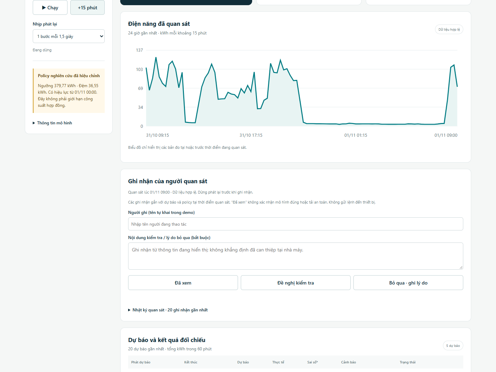
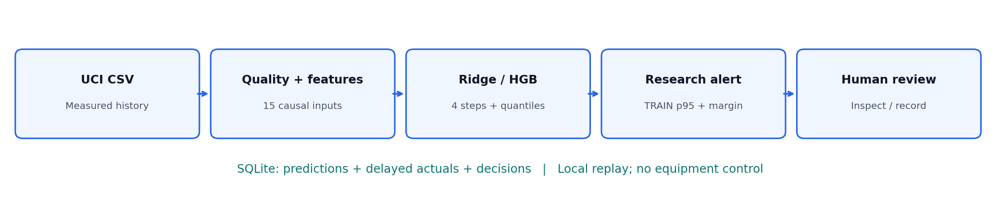
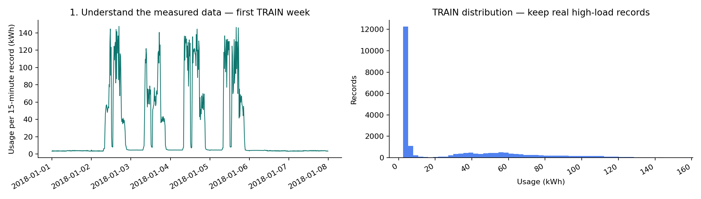
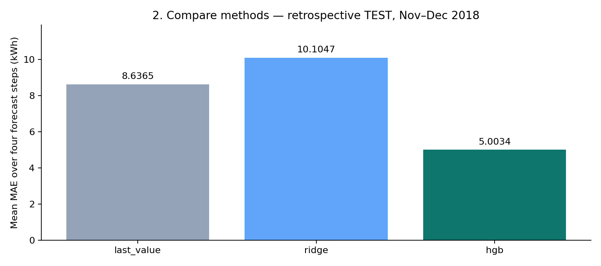
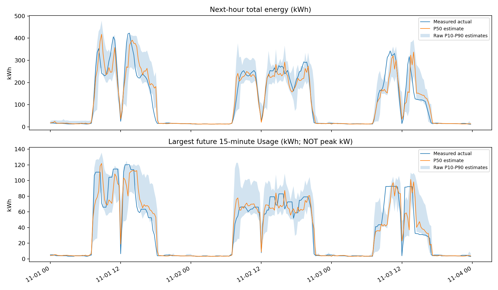
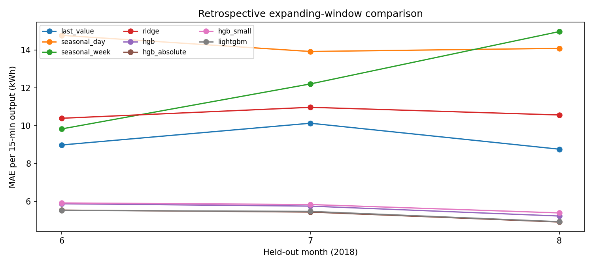
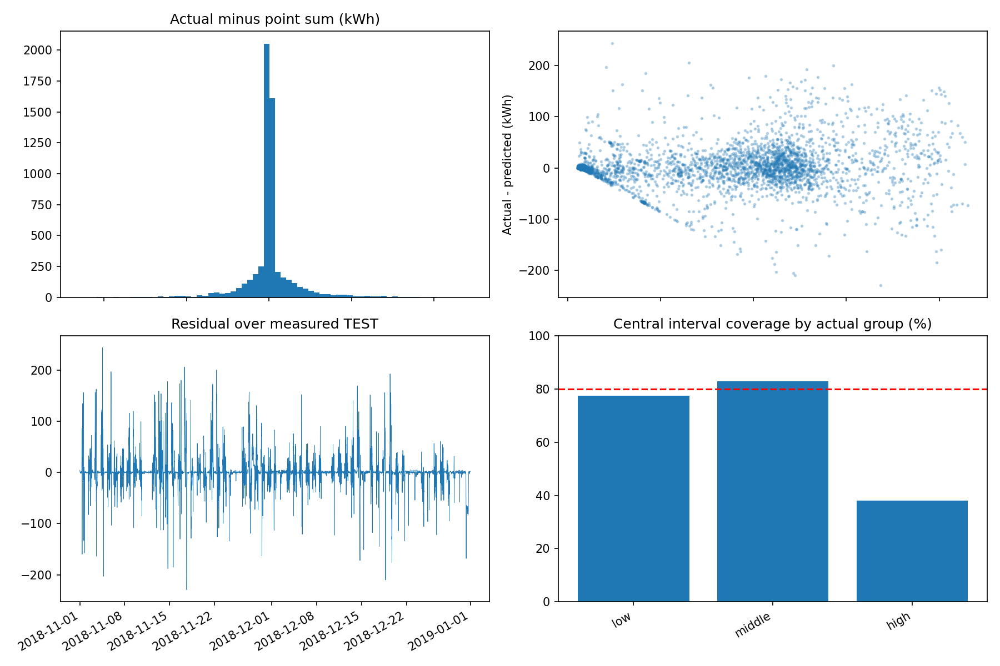
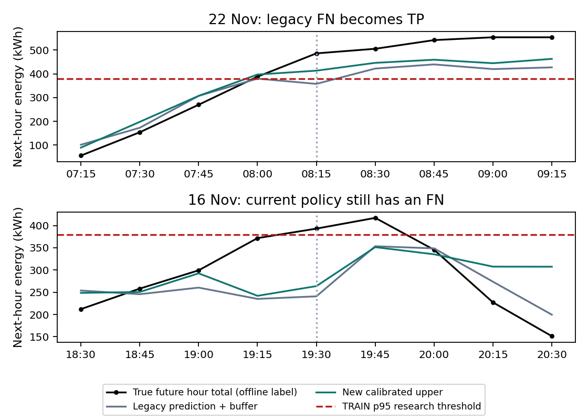

# Steel Energy Forecasting

### Dự báo điện năng ngành thép · Đồ án Ứng dụng AI trong Công nghiệp

[](https://github.com/trangkhanh-ai/steel-industry-energy-consumption/actions/workflows/checks.yml)


**Dự báo bốn khoảng điện năng 15 phút trong giờ tiếp theo, ước lượng P10/P50/P90 và hỗ trợ người điều độ kiểm tra các khoảng tiêu thụ cao.** Input chỉ dùng thông tin đã có tại thời điểm dự báo. Đầu ra là **kWh**, chưa chứng minh tránh vượt công suất đỉnh **kW** hoặc tiết kiệm tiền điện.

[Chạy demo](#chạy-demo) · [Dữ liệu](#dữ-liệu-và-tiền-xử-lý) · [Kết quả](#kết-quả-bản-chính) · [Notebook](#notebook-học-và-chạy-thử) · [Đọc code](#bản-đồ-source-code) · [Nguồn](#nguồn-và-tham-khảo)



## Bài toán và đầu ra

- **Người dùng:** người phụ trách năng lượng/điều độ, mô phỏng trong đồ án.
- **Input tại t:** 673 số đo liên tiếp kết thúc ở t, tạo 15 lag/rolling/calendar feature.
- **Dự báo điểm:** Usage tại t+15, t+30, t+45, t+60 phút, đơn vị kWh mỗi bản đo.
- **Phân vị:** P10/P50/P90 của tổng bốn khoảng và của khoảng có điện năng lớn nhất; huấn luyện riêng hai nhãn.
- **Cảnh báo nghiên cứu:** biên trên sau calibration vượt p95 TRAIN; không phải ngưỡng hợp đồng điện.
- **Quyết định:** người xem kiểm tra thông tin vận hành nếu có, ghi nhận thao tác/lý do; demo không gửi lệnh thiết bị.
- **Monitoring:** actual đến từng 15 phút, MAE/độ phủ từ nhãn đã đủ, quality gate và nhật ký trong SQLite.



## Chạy demo

**Môi trường đã kiểm: Python 3.14.3, scikit-learn 1.8.0.** Chạy tại gốc repo. CSV, model và cấu hình đã có sẵn; không cần train để mở demo.

### Windows · PowerShell

```powershell
git clone https://github.com/trangkhanh-ai/steel-industry-energy-consumption.git
cd steel-industry-energy-consumption
python -m venv .venv
.venv\Scripts\python -m pip install -r requirements.txt
.venv\Scripts\python -m scripts.check_steel_demo_environment
.venv\Scripts\python -X utf8 -m scripts.serve_steel_demo --port 8765 --policy reports/steel/release_2026-10-11/locked_policy.json
```

Mở **http://127.0.0.1:8765**:

1. Chọn mốc tháng 11–12/2018, ví dụ **01/11/2018 08:00**.
2. Mở phiên, xem bốn dự báo và phân vị. Actual ban đầu là `—`.
3. Tiến từng 15 phút; sau bốn bước mới đủ actual tổng giờ.
4. Xem cảnh báo, ghi tên/ghi chú và chọn thao tác kiểm tra.
5. Xem MAE/độ phủ phiên; mở metric đầy đủ khi cần. Dừng bằng `Ctrl+C`.

Hoặc `powershell -File scripts/start_steel_demo.ps1`. Linux/macOS thay `.venv\Scripts\python` bằng `.venv/bin/python`.

Backend HTTP Python chuẩn; UI HTML/CSS/JavaScript. Không cần Streamlit, Node, MongoDB, Notion hoặc cloud. Server loopback, chạy tuần tự và một phiên chung, chưa phải hệ thống nhà máy nhiều người dùng.

### Hai phiên bản và nghiên cứu Khánh

| Phần | Artifact | Vai trò |
|---|---|---|
| **Bản chính 14/10** | `reports/steel/release_2026-10-16/forecast_bundle.joblib` | 4 HGB point + 6 HGB quantile; manifest kiểm hash/source/version |
| Đối chứng tổng giờ 11/10 | `reports/steel/duy_2026-10-02/models/hgb_31_leaves.joblib` | Một dự báo tổng giờ, policy ở `release_2026-10-11/locked_policy.json` |
| Nghiên cứu Khánh | `notebooks/artifacts/`, `khanh_gate7_2026-10-11/` | LightGBM lịch sử và ablation validation; không gắn policy này cho HGB |

UI đặt bản mới ở phần chính, ghi nhãn đối chứng cho bản cũ. Buffer cũ không phải P90. Chạy riêng demo cũ bằng cách thêm `--legacy` vào lệnh server. Notebook không ghi đè model/policy.

## Dữ liệu và tiền xử lý

[UCI Steel Industry Energy Consumption](https://archive.ics.uci.edu/dataset/851/steel+industry+energy+consumption): **35.040 hàng × 11 cột**, năm 2018, một cơ sở thép tại Hàn Quốc, không đại diện toàn khu công nghiệp. CSV giữ nguyên byte:

```text
data/steel/raw/Steel_industry_data.csv
SHA-256: 9b1cee6f9cb9cd9df2b95814ca90a9a2ff15b7f5f1fba0fae3c643e82072eacc
```

| Yêu cầu | Xử lý và lý do |
|---|---|
| Broken | Parse đúng format, sort 365 lần timestamp lùi trong raw; kiểm lưới 15 phút/trùng/thiếu |
| Bad Quality | Giữ một bản ghi zero và đỉnh cao khi chưa chứng minh lỗi sensor; chặn NaN/Inf/âm/gap |
| Background | Thiếu lịch máy, sản lượng, hợp đồng và giá điện; không tạo dữ liệu để lấp chỗ thiếu |
| Missing/outlier | Không impute vì CSV không thiếu; không cắt p99 để làm metric đẹp; live thiếu mốc thì từ chối |
| Feature | Lag 0/1/4/96/672, rolling quá khứ, sin/cos lịch đầu khoảng dự báo; không dùng số đo tương lai |
| Scaling/selection | StandardScaler chỉ fit TRAIN cho Ridge; HGB không cần scaler; 15 feature cố định |
| PCA/imbalance | Không PCA/SMOTE: 15 feature dễ giải thích, bài toán hồi quy; giữ tải cao để đánh giá |
| Leakage | Temporal split, purge origin có nhãn vượt ranh giới; không random split, không fit TEST |



| Tập | Thời gian | Origin hợp lệ | Vai trò |
|---|---|---:|---|
| TRAIN | Tháng 1–8/2018 | 22.652 | Fit model/scaler, ngưỡng nghiên cứu |
| VALIDATION | Tháng 9/2018 | 2.876 | Chọn phương pháp point |
| CALIBRATION | Tháng 10/2018 | 2.972 | Hiệu chỉnh biên phân vị |
| TEST | Tháng 11–12/2018 | 5.852 | Đánh giá hồi cứu |

Nhãn là bốn Usage thật tại t+15/30/45/60; chỉ tạo nhãn offline, inference nhận lịch sử ≤ t. TEST đã từng được nhóm xem, **không phải test mù mới**.

## Kết quả bản chính

Nguồn: [metrics.json](reports/steel/release_2026-10-16/metrics.json), [so sánh](reports/steel/release_2026-10-16/point_model_comparison.csv), [prediction từng origin](reports/steel/release_2026-10-16/test_predictions.csv).

| Phương pháp | MAE 4 bước · validation | MAE 4 bước · test | MAE tổng 4 dự báo · test |
|---|---:|---:|---:|
| Last value | 7,3750 | 8,6365 | 31,8140 |
| Ridge + scaler TRAIN | 9,2207 | 10,1047 | 36,0707 |
| **HGB** | **4,6080** | **4,8640** | **15,6415** |

Đơn vị kWh. Chọn HGB bằng validation. MAE từng bước: **3,7663 / 4,5518 / 5,2924 / 5,8456 kWh**. Baseline bốn bước khác baseline tổng giờ gần nhất của bản cũ.



| Nhãn phân vị | MAE P50 · kWh | Độ phủ P10–P90 gốc | Độ phủ sau calibration |
|---|---:|---:|---:|
| Tổng giờ | 16,0951 | 71,9241% | **78,3322%** |
| Max interval | 5,5520 | 71,4798% | **79,6651%** |

**P50 là trung vị**, không phải kỳ vọng/trung bình. P10–P90 có mức phủ danh nghĩa 80%; TEST còn dưới 80%. Calibration dùng tháng 10 theo ý tưởng CQR, không nhận bảo đảm conformal cho chuỗi thời gian phụ thuộc. Clip âm/sắp phân vị; ghi crossing và pinball loss trong metrics. Không cộng các phân vị của từng bước để suy ra phân vị tổng.



### Cảnh báo và ba mức đánh giá

Cùng ngưỡng TRAIN **379,771 kWh**, tính theo origin; cửa sổ một giờ chồng lấp, chưa phải sự cố vật lý.

| Chỉ số hồi cứu | HGB tổng giờ cũ + buffer | Quantile tổng giờ mới + calibration |
|---|---:|---:|
| Precision | 56,50% | 45,45% |
| Recall | 63,13% | **86,59%** |
| Báo giả / bỏ sót | 87 / 66 | 186 / **24** |

- **Model:** MAE/RMSE, pinball loss, coverage, width, crossing.
- **System:** quality gate, parity, actual trễ, hash/model–policy, FP/FN, latency/tài nguyên.
- **Industrial:** ưu tiên kiểm tra và lưu lý do; chưa đo tiết kiệm điện/tiền điện hoặc lead time vận hành.
- Bản mới bỏ sót ít origin hơn nhưng nhiều báo giả hơn; chưa có chi phí vận hành để kết luận tối ưu kinh tế. Episode là nhóm origin liên tiếp, không xác nhận sự kiện tải vật lý.
- UI đo ngày 16/10: p95 **123.09 ms** trên 24 thao tác Edge; chưa đạt 100 ms. [Log browser](reports/steel/release_2026-10-16/browser_final/browser_check.json). Phiên dài 1.440 bước: backend p95 **125.63 ms**, 1.437 nhãn đã đến, watch model mới hoạt động. Hai phép đo khác phạm vi; không coi là SLA.
- Max interval vẫn là **kWh, chưa phải peak kW**. Không có P_limit, biểu giá, BESS hoặc tải được phép giảm; không tự điều khiển máy.
- PSI/sai số là tín hiệu rà soát; chưa tự chẩn đoán nguyên nhân drift hoặc retrain.

## Kiểm chứng và tái tạo

```powershell
.venv\Scripts\python -m unittest discover -s tests -v
.venv\Scripts\python -m scripts.check_repository
.venv\Scripts\python -m scripts.audit_features_and_leakage
.venv\Scripts\python -m scripts.check_duy_handoff --run-dir reports/steel/duy_2026-10-02
.venv\Scripts\python -X utf8 -m scripts.check_probabilistic_run --run-dir reports/steel/release_2026-10-16 --output-file reports/steel/local_verification_01.json
```

Kiểm nhãn CSV, metric/calibration và online–offline parity. **Kiểm local bản publish: 125/125 tests đạt, không skip.** Chọn tên output mới nếu đã có. `check_repository` kiểm cú pháp, notebook, merge marker, link README và file không được publish. Hash kiểm tính toàn vẹn; chỉ nạp Joblib của nguồn nhóm tin cậy.

### Train lại bản chính

```powershell
$env:OMP_NUM_THREADS = '1'
$env:OPENBLAS_NUM_THREADS = '1'
.venv\Scripts\python -X utf8 -m scripts.run_probabilistic_forecast --output-dir reports/steel/local_training_01 --point-loss absolute_error
.venv\Scripts\python -X utf8 -m scripts.check_probabilistic_run --run-dir reports/steel/local_training_01 --output-file reports/steel/local_training_check_01.json
.venv\Scripts\python -X utf8 -m scripts.serve_steel_demo --port 8765 --policy reports/steel/release_2026-10-11/locked_policy.json --probabilistic-model-dir reports/steel/local_training_01
```

4 HGB point + 6 HGB quantile, 180 vòng, 31 lá, loss point `absolute_error`, learning_rate=0,08, L2=1, random_state=42, không early stopping. Protocol ghi trước fit/scoring TEST. Model khác môi trường có thể khác byte/hash: kiểm prediction/metric, không tự gắn policy khác artifact.

Tái tạo model tổng giờ cũ: `python -m scripts.run_duy_pipeline --output-dir reports/steel/local_hourly_01`. Tạo lại ảnh README: `python -m scripts.build_readme_assets`.

## Bản cải tiến ngày 16/10 và đáp án cố định

**Không cần chạy notebook để lấy số báo cáo.** Artifact, prediction từng origin, bảng/biểu đồ và checksum đã lưu trong [release 16/10](reports/steel/release_2026-10-16/results_summary.json). Xem và kiểm toàn bộ đáp án:

```powershell
.venv\Scripts\python -X utf8 -m scripts.show_results
```

| Chỉ số kWh | Bản 14/10 | Bản 16/10 |
|---|---:|---:|
| Walk-forward MAE/bước, 3 tháng | 5,6029 | **5,2802** |
| Validation tháng 9 MAE/bước | 4,7665 | **4,6080** |
| TEST MAE/bước | 5,0034 | **4,8640** |
| TEST MAE tổng giờ | 16,0661 | **15,6415** |
| TEST RMSE tổng giờ | **31,9771** | 32,5086 |

- Point đổi sang `absolute_error` vì tốt hơn ở cả ba fold và validation. TEST đã được xem từ trước; đây là so sánh hồi cứu. **RMSE tăng**, không kết luận tốt hơn mọi tiêu chí.
- Thử 8 phương pháp/cấu hình trên cùng 15 feature/4 nhãn: last value, seasonal ngày/tuần, Ridge, HGB gốc, HGB MAE, HGB 15 lá và LightGBM. Trong cấu hình đã thử, HGB MAE có pooled MAE tốt nhất; không tuyên bố tối ưu mọi thuật toán.
- Ablation giữ 15 feature: thêm hai delta không cải thiện nhất quán; bỏ lịch hoặc rolling làm kết quả kém hơn. Xem [bảng ablation](reports/steel/improvements_2026-10-16/feature_ablation.csv).
- Thử biên trên một phía 90% trên CAL: FN vẫn 24, FP tăng từ 186 lên 187/193. **Giữ calibration cũ**, lưu [kết quả đối chứng](reports/steel/improvements_2026-10-16/calibration_comparison.csv).
- Nhóm actual cao có 179 origin: coverage chỉ **37,99%**, MAE tổng giờ bản mới **79,9584 kWh**. Đây là phân nhóm offline bằng nhãn; chưa biết nguyên nhân vận hành. [Bảng lỗi](reports/steel/error_analysis_2026-10-16/conditional_errors.csv).
- Monitoring mới dùng reference CAL tháng 10 và đúng bundle hash; đủ 1.344 nhãn liên tục mới xét hai cửa sổ 7 ngày, MAE > 1,2 lần reference hoặc coverage giảm hơn 10 điểm phần trăm ở cả hai. Đây là heuristic; không tự retrain/điều khiển.
- Snapshot chỉ giải mã JSON dự báo mới, vẫn đọc/lọc actual theo `as_of`. Profile đã xác nhận chi phí JSON lặp; SQLite WAL/FULL và nhật ký bất biến được giữ. Benchmark local trước/sau có tải nền khác nhau, không quy toàn bộ chênh lệch cho tối ưu cache.
- [Chi tiết thay đổi và quyết định](reports/steel/release_2026-10-16/changes.json), [kiểm phần mềm](reports/steel/release_2026-10-16/system_verification.json), [khóa kết quả](reports/steel/release_2026-10-16/results_lock.json). Giữ nguyên release 14/10.




Tái lập nghiên cứu khi cần (tùy chọn, không cần để đọc đáp án):

```powershell
.venv\Scripts\python -m pip install -r requirements-khanh.txt
.venv\Scripts\python -X utf8 -m scripts.run_improvement_study --include-lightgbm --output-dir reports/steel/local_study_01
.venv\Scripts\python -X utf8 -m scripts.benchmark_replay --steps 1440 --output-dir reports/steel/local_benchmark_01
```

## Notebook học và chạy thử

Cài `python -m pip install -r requirements-notebooks.txt`, mở bằng VS Code/Jupyter, chọn kernel `.venv`. Không cần notebook dependencies để chạy dashboard.

| Notebook | Nội dung |
|---|---|
| [08 · Kết quả cải tiến](notebooks/08_measured_improvements.ipynb) | **Bản hiện tại 16/10:** kết quả có sẵn, walk-forward, ablation, calibration và lỗi |
| [01 · Data preparation](notebooks/01_data_preparation.ipynb) | 3B, chất lượng, feature/split, EDA TRAIN; dùng hàm source chính |
| [05 · Four-step forecasting (bản 14/10)](notebooks/05_four_step_quantile_forecasting.ipynb) | Bản 14/10 giữ để đối chiếu: baseline/Ridge/HGB, quantile, prediction, actual trễ |
| [06 · Warning cases](notebooks/06_warning_case_studies.ipynb) | Ca FN 08:15/TP 09:00 ngày 22/11 Khánh đề xuất; đối chiếu hai bản |
| [07 · Error analysis](notebooks/07_error_analysis.ipynb) | Đánh giá cũ/mới, ca lỗi thật, kết quả theo tháng và giới hạn công nghiệp |
| [02 · Hourly evaluation](notebooks/02_steel_modeling_evaluation.ipynb) | Đánh giá tổng giờ cũ 11/10; không ghi lại policy |
| [03 · Duy hourly study](notebooks/03_duy_steel_data_and_models.ipynb) | Dữ liệu, leaderboard validation và inference tổng giờ cũ |
| [04 · Khánh study](notebooks/04_khanh_lightgbm_study.ipynb) | LightGBM 15/19 feature, tách khỏi bản chính |

Đã kiểm đủ tám notebook; [biên bản thực thi và số cell chính xác](reports/steel/notebook_verification_2026-10-16.json). Chạy cả tám notebook bằng đúng Python đang dùng, lưu kết quả vào folder mới và kiểm CSV/model/policy bất biến:

```powershell
.venv\Scripts\python -X utf8 -m scripts.run_notebooks --output-dir reports/steel/local_notebook_check_01
```

### Nghiên cứu Khánh

Bốn feature thực: `steel_ramp_rate`, `apparent_energy_proxy`, `reactive_ratio`, `low_lagging_pf_flag`; **không có `load_type_encoded` trong bộ 19**. Proxy điện năng không gọi là công suất biểu kiến; PF thấp không chứng minh bị phạt tiền.

Validation LightGBM MAE **14,558653 → 14,087299 kWh** (giảm khoảng 3,24%). Study dùng nhãn tổng giờ và cửa sổ pandas lịch sử; không so validation của nó với TEST bốn bước như cùng thí nghiệm. Notebook 04 chỉ đọc kết quả. Muốn train study riêng:

```powershell
.venv\Scripts\python -m pip install -r requirements-khanh.txt
.venv\Scripts\python -m scripts.run_feature_extension --output-dir reports/steel/local_gate7_01
.venv\Scripts\python -m scripts.check_khanh_lightgbm --output-dir reports/steel/local_lightgbm_check_01
```

## Bản đồ source code

### Phân tích lỗi và độ ổn định trên dữ liệu thật

```powershell
.venv\Scripts\python -X utf8 -m scripts.analyze_forecast_errors --output-dir reports/steel/local_error_analysis_01
```

[Kết quả kiểm lại ngày 15/10](reports/steel/error_analysis_2026-10-16/verification.json) xác nhận nhãn với CSV gốc, tái tính prediction/buffer của đối chứng cũ, kiểm parity online cho bốn ca và đối chiếu với lần train mới. Model và ngưỡng không được chỉnh theo TEST.

- 08:15 ngày 22/11: FN ở bản cũ, **TP ở bản mới**. Actual tổng giờ 486,25 kWh khác Usage tại origin 41,51 kWh.
- 19:30 ngày 16/11: bản mới vẫn FN, actual tổng giờ 393,05 kWh nhưng biên trên 263,85 kWh.
- MAE tổng bốn dự báo tháng 11/12: **18,9728 / 12,4134 kWh**; coverage **80,10% / 76,62%**. MAE thấp hơn chưa bảo đảm độ phủ tốt hơn.
- [Bảng cảnh báo](reports/steel/error_analysis_2026-10-16/alert_comparison.csv), [ca minh họa](reports/steel/error_analysis_2026-10-16/case_studies.csv), [theo tháng](reports/steel/error_analysis_2026-10-16/monthly_metrics.csv). Những ca chọn để giải thích không thay thế metric trên cả TEST.
- [Phạm vi công nghiệp](reports/steel/error_analysis_2026-10-16/industrial_scope.json): chưa đo điện/tiền tiết kiệm, lead time thiết bị hoặc số lượt kiểm tra thực; không có điều khiển tự động.



### Các thư mục và module

```text
src/steel/       Logic xử lý, feature, model, policy, evaluation, monitoring
scripts/         Lệnh train/audit/notebook/kiểm chứng/server
tests/           Kiểm dữ liệu, leakage, hash, actual trễ, replay, policy
web/steel_demo/  HTML / CSS / JavaScript
notebooks/       Tám notebook; artifact Khánh riêng
data/steel/      CSV gốc, processed cho đối chứng/nghiên cứu
reports/steel/   Model, prediction CSV, metric JSON, hình thực nghiệm
assets/          Ảnh README/dashboard từ dữ liệu và UI thật
configs/        Cấu hình thí nghiệm cũ để tái lập
.github/        CI source/tests/artifact
```

| Đọc theo thứ tự | File và trách nhiệm |
|---|---|
| Dữ liệu | [preprocessing.py](src/steel/preprocessing.py): schema/time/quality, nhãn tổng giờ, split/purge |
| Feature | [duy_forecasting.py](src/steel/duy_forecasting.py): batch; [live_features.py](src/steel/live_features.py): một hàng từ lịch sử |
| Train mới | [run_probabilistic_forecast.py](scripts/run_probabilistic_forecast.py): baseline/Ridge/HGB, selection, calibration, scoring |
| Inference/metric | [probabilistic.py](src/steel/probabilistic.py): 4 bước, quantile, manifest, actual trễ |
| Kiểm kết quả | [check_probabilistic_run.py](scripts/check_probabilistic_run.py): nhãn CSV, metric, parity |
| Demo/SQLite | [demo.py](src/steel/demo.py), [monitoring.py](src/steel/monitoring.py), [serve_steel_demo.py](scripts/serve_steel_demo.py) |
| Khánh | [feature_extension.py](src/steel/feature_extension.py), [run_feature_extension.py](scripts/run_feature_extension.py) |

**Lưu trữ thực:** CSV giữ raw, Pandas/NumPy xử lý; SQLite lưu `forecasts`, `requests`, `decisions`, `session_metadata` tại `reports/steel/modeling/demo_sessions/<session>/monitor.sqlite3`. Model lưu Joblib/JSON. Chưa thu trực tiếp từ công tơ/gateway hoặc lưu mọi số đo raw vào SQLite; không cần hệ phân tán cho 35.040 hàng.

## Xử lý lỗi

| Triệu chứng | Cách xử lý |
|---|---|
| Thiếu module | Dùng `.venv`, cài đúng requirements; notebook/LightGBM/Playwright có file riêng |
| Model/source hash sai | Kiểm version/byte; không bỏ quality gate hoặc tắt kiểm hash |
| Output đã có | Chọn tên mới, giữ bằng chứng cũ |
| Cổng bận | Đổi `--port 8766`, mở đúng URL |
| Actual `—` | Tiến từng 15 phút; tổng cần đủ 4 số đo, không điền số giả |
| CRLF/LF của LightGBM | Kiểm byte thực; test không giả định newline của mọi checkout. LightGBM vẫn không được kích hoạt cho HGB |

Kiểm UI tùy chọn: cài `requirements-ui-test.txt`, có Microsoft Edge, chạy server rồi `python -m scripts.check_steel_demo_browser --url http://127.0.0.1:8765 --output-dir reports/steel/local_browser_01`. Kiểm desktop/mobile, actual trễ/reset/log và đo thao tác thật; inference latency không thay UI latency.

## Nhóm và phạm vi công khai

| Thành viên | Trách nhiệm |
|---|---|
| Duy · `dzyuu1612` | Problem/data, preprocessing, baseline/model, tích hợp/rà soát |
| Khánh | Feature/LightGBM, calibration/evaluation, TP/FN, nghiệm thu độc lập |
| Huy | Demo, monitoring, đóng gói, chạy kiểm trên máy khác |

Repo chứa code, một README, notebook và artifact/hình cần chạy, đối chiếu kết quả. Word/slide/PDF bài báo, tài liệu `docs/`, Markdown khác và log cá nhân nằm ngoài bản source. Code cũ truy xuất được qua lịch sử Git.

## Nguồn và tham khảo

- **Dữ liệu:** V. E. Sathishkumar, C. Shin, Y. Cho, *Steel Industry Energy Consumption*, UCI, 2021, DOI [10.24432/C52G8C](https://doi.org/10.24432/C52G8C), **CC BY 4.0**. CSV không chỉnh sửa; nhóm tạo feature/split.
- **HGB/quantile:** [scikit-learn 1.8 API](https://scikit-learn.org/1.8/modules/generated/sklearn.ensemble.HistGradientBoostingRegressor.html), [prediction intervals chính thức](https://scikit-learn.org/1.8/auto_examples/ensemble/plot_gradient_boosting_quantile.html).
- **Calibration:** Romano, Patterson, Candès, [Conformalized Quantile Regression](https://arxiv.org/abs/1905.03222), 2019; áp dụng ý tưởng score, công khai giới hạn chuỗi thời gian.
- **Industrial AI:** Jay Lee, [Industrial AI Applications with Sustainable Performance](https://doi.org/10.1007/978-981-15-2144-7), 2020. Case Study 4 gợi ý nối dự báo với quyết định; không dùng savings của case study làm kết quả nhóm.
- **Storage:** [SQLite appropriate uses](https://www.sqlite.org/whentouse.html), [WAL](https://www.sqlite.org/wal.html), phục vụ demo local/embedded.
- **Tổ chức repo/README:** tham khảo [Cookiecutter Data Science](https://github.com/drivendataorg/cookiecutter-data-science), [scikit-learn](https://github.com/scikit-learn/scikit-learn), [LightGBM](https://github.com/lightgbm-org/LightGBM); điều chỉnh cho nhóm ba người, không sao chép kết quả của các repo đó.

**Lifecycle:** Problem Definition → Data Understanding → Data Preparation → Method Selection → Model Development → Evaluation → Deployment → Monitoring and Improvement. Có code/notebook/artifact để đối chiếu; giá trị công nghiệp chưa đo được giữ đúng trạng thái chưa đo.
