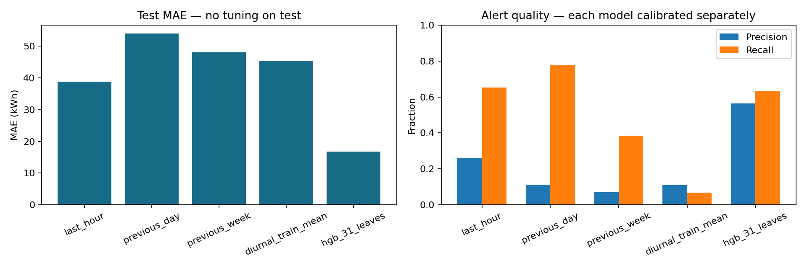
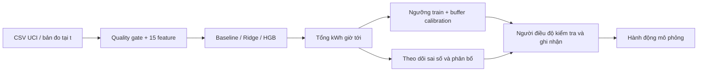

# Steel Energy Forecasting

### Dự báo điện năng ngành thép · Đồ án Ứng dụng AI trong Công nghiệp


**Dự báo tổng điện năng tiêu thụ trong 60 phút tiếp theo, cảnh báo khoảng tiêu thụ cao và hỗ trợ người điều độ kiểm tra.** Bản đo cách nhau 15 phút tại một cơ sở sản xuất thép. Đầu ra là một tổng **kWh**, không phải bốn công suất kW riêng biệt.

[Chạy demo](#chạy-demo) · [Hiểu bài toán](docs/project.md) · [Hướng dẫn đầy đủ](docs/getting_started.md) · [Đọc source](docs/code_map.md) · [Kết quả](docs/results.md)

## Demo có gì?

- Biểu đồ lịch sử, dự báo giờ tới và actual khi đủ 60 phút.
- Ngưỡng lấy từ train; biên đệm hiệu chỉnh bằng tháng 10.
- Cảnh báo, đề nghị kiểm tra đồng hồ/lịch vận hành và nhật ký người xem.
- Theo dõi chất lượng đầu vào, sai số, phân bố dữ liệu và độ trễ.
- Trạng thái rõ ràng khi thiếu dữ liệu, sai model hoặc policy không tương thích.


## Chạy demo

Windows / PowerShell, **Python 3.14**:

```powershell
git clone https://github.com/trangkhanh-ai/steel-industry-energy-consumption.git
cd steel-industry-energy-consumption
python -m venv .venv
.venv\Scripts\python -m pip install -r requirements.txt
.venv\Scripts\python -m scripts.check_steel_demo_environment
.venv\Scripts\python -X utf8 -m scripts.serve_steel_demo --port 8765 --policy reports/steel/release_2026-10-11/locked_policy.json
```

Mở **http://127.0.0.1:8765** → chọn mốc tháng 11–12/2018 → mở phiên → tiến từng bước 15 phút → xem cảnh báo và ghi nhận kiểm tra. Actual chỉ xuất hiện sau đủ bốn bản đo tương lai. Dừng bằng `Ctrl+C`.

Linux/macOS dùng `.venv/bin/python`. CSV gốc, model HGB và policy đã có trong repo. Không cần Streamlit hoặc tài khoản Notion để chạy. [Huấn luyện, đánh giá, notebook và xử lý lỗi](docs/getting_started.md).

## Kết quả đã kiểm lại

Test hồi cứu **tháng 11–12/2018: 5.852 mốc**; model HGB đã khóa trước calibration/test:

| Chỉ số | Baseline giờ gần nhất | HGB 31 lá |
|---|---:|---:|
| MAE, kWh | 38,7626 | **16,7351** |
| RMSE, kWh | 77,7645 | **32,7762** |
| Precision cảnh báo | 0,2600 | **0,5650** |
| Recall cảnh báo | **0,6536** | 0,6313 |
| Báo giả / bỏ sót theo mốc | 333 / 62 | **87 / 66** |

HGB giảm **56,83% MAE**, báo giả ít hơn và bỏ sót thêm **4 mốc**. Đây là giảm sai số, không phải phần trăm tiết kiệm điện. Mỗi phương pháp dùng buffer calibration của riêng mình. Ngưỡng **379,771 kWh**; buffer HGB **36,551681 kWh**. Độ phủ thực nghiệm biên trên **93,15%**, chưa phải P90 có bảo đảm.



Số đầy đủ và dự báo từng hàng: [metrics.json](reports/steel/release_2026-10-11/metrics.json), [kết quả/giới hạn](docs/results.md). Test đã từng được xem; lần này kiểm khả năng tái lập, không gọi là test mù mới.

## Từ dữ liệu đến quyết định



**Giá trị công nghiệp:** thông tin trước một giờ để ưu tiên kiểm tra các khoảng tiêu thụ cao, giảm khối lượng kiểm tra do báo giả trong đánh giá hồi cứu và lưu lý do quyết định. Dataset chưa có giá điện, công suất hợp đồng, lịch máy, sản lượng hoặc can thiệp vận hành để chứng minh tiết kiệm thực. Demo không điều khiển thiết bị.

## Cấu trúc repo

```text
data/steel/       CSV gốc bất biến, processed và data README
src/steel/        Logic xử lý, dự báo, evaluation, policy, monitoring
scripts/          Lệnh chạy pipeline, kiểm tra, demo và nghiên cứu
notebooks/        Notebook đánh số; nghiên cứu Khánh có mục riêng
web/steel_demo/   HTML / CSS / JavaScript của demo
tests/            Kiểm dữ liệu, leakage, model, policy và replay
reports/steel/    Bằng chứng thực nghiệm CSV / JSON / hình / ghi chú kỹ thuật
docs/             Hướng dẫn, problem card, rubric và tài liệu tham khảo
assets/           Ảnh giới thiệu demo
.github/          Kiểm source tự động
```

`reports/steel/` chứa bằng chứng thực nghiệm, không chứa báo cáo Word/PDF hoặc bài báo. [Bản đồ module và thứ tự đọc](docs/code_map.md).

## Kiểm tra và nghiên cứu thêm

```powershell
.venv\Scripts\python -m unittest discover -s tests -v
.venv\Scripts\python -m scripts.check_repository
.venv\Scripts\python -m scripts.audit_features_and_leakage
.venv\Scripts\python -m scripts.check_duy_handoff --run-dir reports/steel/duy_2026-10-02
```

Khánh có [study 15/19 feature trên validation](scripts/run_feature_extension.py) và [kiểm artifact LightGBM 15 feature](scripts/check_khanh_lightgbm.py). Cài `requirements-khanh.txt` khi cần; không trộn model/buffer LightGBM với HGB. [Kết quả và lỗi đã sửa](docs/results.md).

## Nhóm và tham khảo

| Thành viên | Phần phụ trách |
|---|---|
| Duy — `dzyuu1612` | Problem, dữ liệu, baseline/model, tích hợp và rà soát source |
| Khánh | Feature/LightGBM, calibration và evaluation |
| Huy | Demo, monitoring, môi trường và bàn giao policy |

- Dữ liệu: [UCI Steel Industry Energy Consumption](https://archive.ics.uci.edu/dataset/851/steel+industry+energy+consumption), DOI **10.24432/C52G8C**, **CC BY 4.0**; [attribution](data/steel/README.md).
- Phương pháp: scikit-learn/LightGBM; bối cảnh Industrial AI/3B: Jay Lee (2020). [Nguồn và cách áp dụng](docs/references.md).
- Cách tổ chức tham khảo [Cookiecutter Data Science](https://github.com/drivendataorg/cookiecutter-data-science), [scikit-learn](https://github.com/scikit-learn/scikit-learn) và [LightGBM](https://github.com/lightgbm-org/LightGBM), điều chỉnh cho nhóm ba người.

[Đối chiếu 8 bước](docs/project.md) · [Kế hoạch nhóm](docs/team/ke_hoach_nhom_3_nguoi.md) · [Quy tắc đóng góp](CONTRIBUTING.md) · [Lịch sử thay đổi](CHANGELOG.md)
